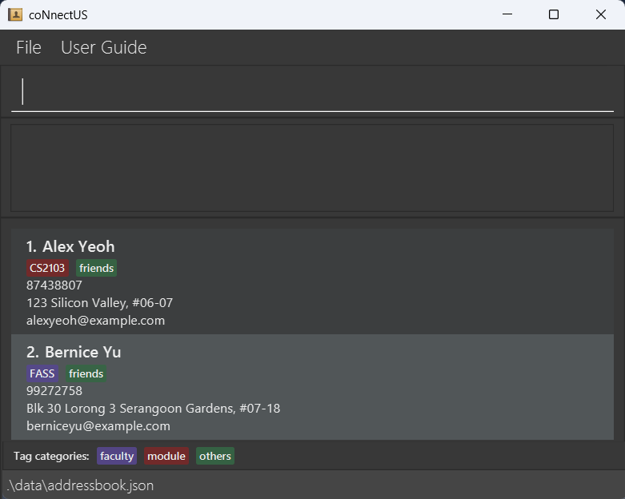
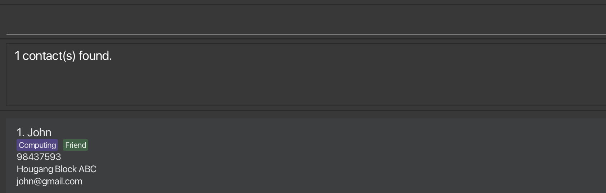
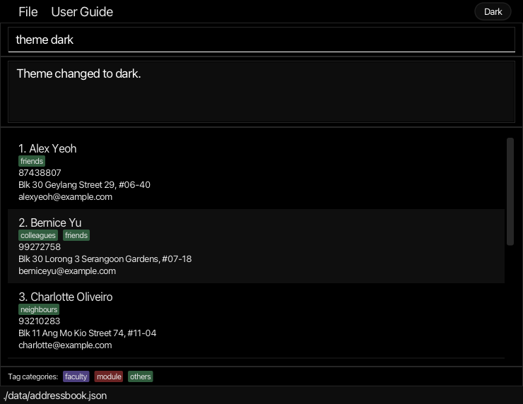
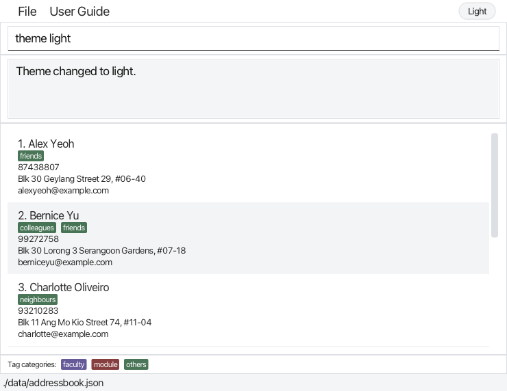

# coNnectUS User Guide

coNnectUS is a **desktop Address Book application designed for NUS students** to manage their contacts. It is **optimized for use through a Command Line Interface (CLI)** while retaining the benefits of a Graphical User Interface (GUI). If you type quickly, coNnectUS can help you manage contacts faster than traditional GUI applications.

<!-- * Table of Contents -->
<page-nav-print />

--------------------------------------------------------------------------------------------------------------------

## Quick start

1. Ensure that Java `25` or later is installed on your computer. 
   **Mac users:** Ensure you have the precise JDK version prescribed [here](https://se-education.org/guides/tutorials/javaInstallationMac.html).

1. Download the latest `.jar` file from [here](https://github.com/AY2627S1-CS2103T-T13-1/tp/releases).

1. Copy the file to the folder you want to use as the _home folder_ for your instance of coNnectUS.

1. Open a terminal, `cd` to the folder containing the JAR file, and run `java -jar coNnectUS.jar`. 
   A GUI similar to the one below should appear in a few seconds. Note how the app contains some sample data. 
   

1. Type a command in the command box and press Enter to execute it. For example, type **`help`** and press <kbd>Enter</kbd> to view the commands available. 
   Some example commands you can try:

   * `list` : Lists all contacts.

   * `add -n John Doe -p 98765432 -e johnd@example.com -a John street, block 123, #01-01` : Adds a contact named `John Doe` to the Address Book.

   * `delete 3` : Deletes the 3rd contact shown in the current list.

   * `clear` : Deletes all contacts.

   * `exit` : Exits the app.

1. Refer to the [Features](#features) section below for details of each command.

--------------------------------------------------------------------------------------------------------------------

## Features

<box type="info" seamless>

**Notes about the command format:** 

* Words in `UPPER_CASE` are the parameters to be supplied by the user. 
  For example, in `add -n NAME`, replace `NAME` with a value such as `John Doe`.

* Items in square brackets are optional. 
  For example, `-n NAME [-t CATEGORY TAG]` can be used as `-n John Doe -t others friend` or as `-n John Doe`.

* Items followed by `...` can appear zero or more times. 
  For example, `[-t CATEGORY TAG]... ` may be omitted, or written as `-t others friend` or `-t others friend -t others family`.

* Parameters can be in any order. 
  For example, if the command specifies `-n NAME -p PHONE_NUMBER`, `-p PHONE_NUMBER -n NAME` is also acceptable.

* Extraneous parameters for commands that take no parameters, such as `help`, `list`, `exit`, and `clear`, are ignored. 
  For example, `help 123` is interpreted as `help`.

* If you are using a PDF version of this document, be careful when copying and pasting commands that span multiple lines as space characters surrounding line-breaks may be omitted when copied over to the application.
</box>

### Viewing help: `help`

Displays the list of commands, their usages, descriptions, examples and the link for the User Guide.

Format: `help`

### Adding a person: `add`

Adds a person to the address book.

Format: `add -n NAME -p PHONE_NUMBER -e EMAIL [-a ADDRESS] [-t TAG_CATEGORY TAG_NAME]... `

<box type="tip" header="**Tips**" seamless>

- A person can have any number of tags, including zero.
- Refer to [Tagging a person](#tagging-a-person) for more information on tags.
- The address parameter is optional.

</box>

Examples:
* `add -n John Doe -p 98765432 -e johnd@example.com -a John street, block 123, #01-01`
* `add -n Betsy Crowe -t others friend -e betsycrowe@example.com -a Newgate Prison -p 1234567 -t others criminal`
* `add -n Jane Tan -p 87654321 -e janetan@example.com`

### Listing all persons: `list`

Shows a list of all persons in the address book.

Format: `list`

### Editing a person: `edit`

Edits an existing person in the address book.

Format: `edit INDEX [-n NAME] [-p PHONE_NUMBER] [-e EMAIL] [-a ADDRESS] [-t TAG_CATEGORY TAG_NAME]... `

* Edits the person at the specified `INDEX`. The index refers to the index number shown in the displayed person list. The index **must be a positive integer** 1, 2, 3, ...
* At least one of the optional fields must be provided.
* Existing values will be updated to the input values.
* When editing tags, all of the person's existing tags are removed; adding tags is not cumulative.
* To remove all of a person's tags, enter `-t` without a tag after it.
* To remove a person's address, enter `-a` without an address after it.
* Refer to [Tagging a person](#tagging-a-person) for more info on tags.

Examples:
*  `edit 1 -p 91234567 -e johndoe@example.com` Edits the phone number and email address of the 1st person to be `91234567` and `johndoe@example.com` respectively.
*  `edit 2 -n Betsy Crower -t` Edits the name of the 2nd person to be `Betsy Crower` and clears all existing tags.
*  `edit 3 -a` Removes the address of the 3rd person.

### Locating persons by criteria: `find`

Finds persons in the address book matching the supplied criteria.

Format: `find [-n NAME] [-p PHONE_NUMBER] [-e EMAIL] [-a ADDRESS] [-t TAG_CATEGORY TAG_NAME]...`

* At least one criterion must be specified.
* Multiple tags can be supplied, but other parameters (name, phone, email, address) may only be specified once.
* Every criterion supplied must match to find a person.
* Search criteria are case-insensitive. For example, `-n hans` matches `-n Hans`.
* Persons are matched if the search criterion is a substring of the actual field; for example `-n John` matches `John` and `Johnny`.
* For tag criteria, both a valid category (i.e. `module`, `faculty` or `others`) and the tag name must be supplied.
* Refer to [Tagging a person](#tagging-a-person) for a list of valid tag categories.

Examples:
* `find -n john` returns `John`, `Johnny`.
* `find -e alice` returns `alice@example.com`, `alicelow@gmail.com`
* `find -p 92` returns `92005000`, `88922301`
* `find -t others Friend -t faculty Computing` returns persons who have both tags. 
  

### Deleting a person or multiple people: `delete`

Deletes either the specified person (based on list index), or people matching the supplied tag set from the address book.

Format: `delete INDEX` OR `delete -t TAG_CATEGORY TAG_NAME...`

<ins>__Index-based deletion:__</ins>

* Deletes the person at the specified `INDEX`.
* The index refers to the index number shown in the displayed person list.
* The index **must be a positive integer** 1, 2, 3, ...

<ins>__Tag-based deletion:__</ins>

* Deletes people whose __complete set of tags exactly matches the supplied tags__. 
* One or more tags can be specified.
* Matching people not displayed in the active filter will still be deleted.
* Tag categories and tag names are compared case-insensitively. 
* If there are no matches, no deletion will occur.

Examples:
* `list` followed by `delete 2` deletes the 2nd person in the address book.
* `find -n Betsy` followed by `delete 1` deletes the 1st person in the results of the `find` command.
* `delete -t faculty Science` deletes all people with only the faculty tag `Science`.
* `delete -t module TJ3000 -t others Badminton` deletes all people with only the module tag `TJ3000` and others tag `Badminton`. (Persons missing any of the exact tags OR having extra tags will __not__ be matched)

### Pinning and unpinning a person

Persons can be pinned to be displayed on top of unpinned contacts, and unpinned to be displayed amongst unpinned contacts.

Format: `pin INDEX`, `unpin INDEX`

* Pins the person at the specified `INDEX`.
* The index refers to the index number specified in the displayed person list (either using `find` or `list`).
* The index **must be a positive integer**.
  * If using `pin`, the person specified at `INDEX` **must be** an unpinned person.
  * If using `unpin`, the person specified at `INDEX`  **must be** a pinned person.

Examples:
* `list` followed by `pin 3` pins the 3rd person in the address book.
* `find -n Bob` followed by `pin 5` pins the 5th person in the results of the `find` command. 
* `find -e mary@gmail.com` followed by `unpin 1` unpins the 1st person in the results of the `find` command.

### Tagging a person

Tags can be added to a person through the [Edit](#editing-a-person-edit) or the [Add](#adding-a-person-add) commands.

The following tag categories are supported, with each category being assigned a unique colour code:
- module
- faculty
- others

Tag categories are not case-sensitive.
- `add ... -t OTHERS friend` has the same effect as `add ... -t oThErS friend`.

### Clearing all entries: `clear`

Clears all entries from the address book.

Format: `clear`

### Undoing a change: `undo`

Reverses the most recent command that changed your contact list.

Format: `undo`

* Commands that can be undone: `add`, `edit`, `delete`, `clear`, `pin`, `unpin`, `import`.
* Other commands, such as `list`, `find`, `theme` and `alias`, are skipped. `undo` reverses the most recent command that changed your contact list.
* You can use `undo` several times in a row to reverse earlier changes one at a time.
* After an undo, all contacts are shown, with pinned contacts at the top.
* The undo history is cleared when you close coNnectUS.

Examples:
* `delete 2` followed by `undo` brings back the deleted contact.
* `pin 1`, `edit 3 -n John Doe`, then `undo` twice reverses the edit and then the pin.

### Importing contacts: `import`

Imports contacts from a JSON address book file and merges them into the current address book.

Format: `import -f FILE_PATH`

* `FILE_PATH` is the path to a JSON address book file.
* Contacts with the same phone number or email address as an existing contact are skipped.
* Imported contacts are added to the current address book; existing contacts are not replaced.
* The command displays the number of imported and skipped contacts.
* The imported contacts can be removed using `undo`.

Example:

* `import -f data/exports/contacts.json`

### Redoing an undone change: `redo`

Reapplies the most recent change that was reversed by `undo`.

Format: `redo`

* You can use `redo` several times in a row to reapply undone changes one at a time, in the order they were made.
* Making a new change after an `undo` (e.g. `add`, `edit` or `delete`) clears the redo history, so the undone changes can no longer be redone.
* Commands that do not change your contact list, such as `list` and `find`, do not clear the redo history.
* After a redo, all contacts are shown, with pinned contacts at the top.

Examples:
* `delete 2`, `undo`, then `redo` deletes the contact again.
* `delete 2`, `undo`, `add -n Jane Tan -p 87654321 -e janetan@example.com`, then `redo` shows an error, because adding Jane Tan cleared the redo history.

### Changing the theme: `theme`

Switches coNnectUS between a dark theme (true black, which saves power on OLED screens) and a light theme (white).

Format: `theme dark` or `theme light`

* The theme name is not case-sensitive. For example, `theme LIGHT` works the same as `theme light`.
* You can also click the **Dark** / **Light** button at the right end of the menu bar to switch to the other theme.
* The User Guide window changes to the same theme.
* coNnectUS remembers your theme and opens with it the next time you start the app. The first time you start the app, it opens in the dark theme.

Examples:
* `theme light` switches to the light theme.
* `theme dark` switches back to the dark theme.

  
  

### Exiting the program: `exit`

Exits the program.

Format: `exit`

### Saving the data

coNnectUS automatically saves data after every command. You do not need to save manually.

Your window size, window position and theme are saved in `[JAR file location]/preferences.json` when you close the app.

### Editing the data file

The address book application data is saved automatically as a JSON file `[JAR file location]/data/addressbook.json`. Advanced users are welcome to update data directly by editing that data file.

<box type="warning" seamless>

**Caution:**
If your changes make the data file invalid, coNnectUS starts with an empty address book at the next run. The invalid file remains on disk until you run a command (coNnectUS saves after every command). Still, we recommend backing up the file before editing it. 
Furthermore, certain edits can cause the coNnectUS to behave in unexpected ways (e.g., if a value entered is outside the acceptable range). Therefore, edit the data file only if you are confident that you can update it correctly.
</box>

--------------------------------------------------------------------------------------------------------------------

## FAQ

**Q**: How do I transfer my data to another computer? 
**A**: Install the app on the other computer and overwrite the data file it creates with the data file from your previous coNnectUS home folder.

--------------------------------------------------------------------------------------------------------------------

## Known issues

1. **When using multiple screens**, if you move the application to a secondary screen, and later switch to using only the primary screen, the GUI will open off-screen. The remedy is to delete the `preferences.json` file created by the application before running the application again.
2. **If you minimize the User Guide Window** and then use the `User Guide` menu, or the keyboard shortcut `F1` again, the original User Guide Window may remain minimized, and no new User Guide Window will appear. The remedy is to manually restore the minimized User Guide Window.

--------------------------------------------------------------------------------------------------------------------

## Command summary

Action     | Format, Examples
-----------|----------------------------------------------------------------------------------------------------------------------------------------------------------------------
**Add**    | `add -n NAME -p PHONE_NUMBER -e EMAIL [-a ADDRESS] [-t TAG_CATEGORY TAG_NAME]... `   e.g., `add -n James Ho -p 22224444 -e jamesho@example.com -a 123, Clementi Rd, 1234665 -t others friend -t others colleague`
**Clear**  | `clear`
**Delete** | `delete INDEX` OR `delete -t TAG_CATEGORY TAG_NAME...`  e.g., `delete 3`, `delete -t faculty CDE`
**Edit**   | `edit INDEX [-n NAME] [-p PHONE_NUMBER] [-e EMAIL] [-a ADDRESS] [-t TAG_CATEGORY TAG_NAME]... `  e.g.,`edit 2 -n James Lee -e jameslee@example.com`
**Find**   | `find [-n NAME] [-p PHONE_NUMBER] [-e EMAIL] [-a ADDRESS] [-t TAG_CATEGORY TAG_NAME]... `  e.g.,`find -n James -p 2222 -t others friend`
**Pin**    | `pin INDEX`
**Unpin**  | `unpin INDEX`
**List**   | `list`
**Theme**  | `theme dark` or `theme light`  e.g., `theme light`
**Undo**   | `undo`
**Redo**   | `redo`
**Help**   | `help`
**Import** | `import -f FILE_PATH` e.g., `import -f data/exports/contacts.json`
